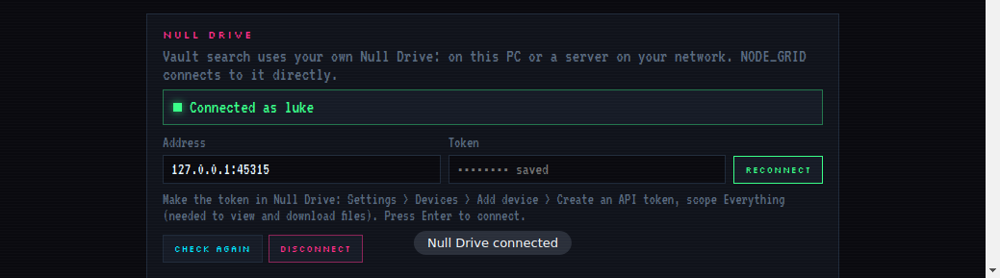

# Null Grid

**A vertical-tab desktop browser with ad blocking, a login vault, and a direct line to your own files.** It's part of the **[Null](https://nullgrid.dev)** Suite by Null Labs, alongside Null Search, Null Notes and Null Drive. (Formerly NODE_GRID.)



## Features

- **Vertical tab sidebar** — tabs, favorites, hostname-only history (no pages, no searches, last 100 sites / 7 days), and a **login vault** (`safeStorage`-encrypted).
- **Ad + tracker blocking** (`@ghostery/adblocker-electron`), pausable per site.
- **Burner tabs** — throwaway, wipe-itself storage; nothing they touch is kept.
- **Dark pages**, forced on any site, bright or not.
- **A built-in radio player** in the sidebar, playable from any tab.
- **An AI side panel** — Claude by default, or your own pick (ChatGPT, Gemini, Grok, a local model).
- **Null Search integration** — the start page searches through Null Search, with Vault Matches merging your own notes and Drive files right into web results.
- **A direct Null Drive connection.** The browser itself — not the web page — handshakes with your Null Drive, so your address and token never reach the search origin. See [How it connects to Null Grid](#how-it-connects-to-null-grid).
- **Picture-in-picture, docked in the sidebar.** Pop a video out and, if the sidebar is expanded, it docks into the empty strip below the tab list instead of a floating OS window — it stays there as long as the sidebar stays expanded, with a small restore/close bar over it. Collapse the sidebar (or there's no room) and it falls back to a normal floating PiP window automatically. Toggle it off in Settings if you'd rather always get the floating window.
- **Masking, per tab.** Right-click a page (or its tab) → **Masking**, and that one tab tells sites it's the current Google Chrome instead of an Electron app — for sites like WhatsApp Web that turn away browsers they don't recognise. Every other tab is untouched; pick it again to turn it off.
- **Update bot.** Null Grid asks GitHub once a day whether a newer version is out. If one is, a little pixel robot runs in, hops, and tells you, with a button to get it. Settings → UPDATES has CHECK FOR UPDATES any time and a switch for the daily check. Microsoft Store copies hear about it too, and get the update itself through the Store.
- **YouTube radio stations** play in a small visible player (200 × 200, YouTube's minimum) in the radio panel, and pause while the player is hidden.

## Install

- **Windows:** [Microsoft Store](https://apps.microsoft.com/detail/9PL3D6SNHMLS), or the portable build from [Releases](../../releases).
- **Linux, any distro, no install needed:** download the `.AppImage` for your architecture from [Releases](../../releases), then
  ```
  chmod +x Null-Grid-5.2.0-x86_64.AppImage          # or Null-Grid-5.2.0-arm64.AppImage
  ./Null-Grid-5.2.0-x86_64.AppImage
  ```
- **Ubuntu 24.04+ / Debian 13+ (x64 or arm64):** download the `.deb` from [Releases](../../releases), then
  ```
  sudo apt install ./nullgrid-browser_5.2.0_amd64.deb   # or _arm64.deb
  ```
- **Fedora / openSUSE / RHEL (x64 or arm64):** download the `.rpm` from [Releases](../../releases), then
  ```
  sudo rpm -i nullgrid-browser-5.2.0.x86_64.rpm   # or .aarch64.rpm
  ```
- **Arch (AUR):** [`nullgrid-browser-bin`](packaging/aur/) — `yay -S nullgrid-browser-bin` (or your AUR helper of choice; `aarch64` is listed too). The PKGBUILD/`.SRCINFO` live in this repo; a maintainer pushes them to the actual AUR package repo.
- **Flatpak / Snap (x64):** if a release built them, grab the `.flatpak` or `.snap` from [Releases](../../releases) and install with `flatpak install` / `snap install --dangerous`. Both build in best-effort CI jobs — see [Build from source](#build-from-source) if a given release doesn't have them and you want to build locally. A submission-ready Flathub manifest is at [`packaging/flathub/dev.nullgrid.nullgrid.yml`](packaging/flathub/dev.nullgrid.nullgrid.yml) for getting onto Flathub proper.
- **Any other Linux:** download the `.tar.gz` for your architecture from [Releases](../../releases), unpack it, and run the program inside.

## Make it your default browser

- **Linux (incl. Omarchy):** Settings → DEFAULT BROWSER → **MAKE DEFAULT**. Or by hand: `xdg-settings set default-web-browser node-grid.desktop`
- **Windows (Microsoft Store version):** Settings → DEFAULT BROWSER → **OPEN DEFAULT APPS**, pick Null Grid, and set it for HTTP, HTTPS and .html. (Windows only lets you choose this yourself.)

## How it connects to Null Grid

Null Grid's main process is the only thing that ever talks to Null Drive — never the web page, and never Null Search's own server. `null-drive.js` does the handshake (`GET /api/v1/me`), search, view and download; `window.nullgridDrive`, exposed by `tab-preload.js`, is the one bridge a page can call, and only when it's running inside a Null Grid tab on the configured search origin.

1. Settings → **NULL DRIVE** → enter your address and an API token (Null Drive: Settings → Devices → Add device → Create an API token, scope **Everything** — needed to view and download files; a search-only token can search but not open or download).
2. **If your Drive account is end-to-end encrypted:** Drive turns its search index off for that account by design — Null Grid shows "connected, but this account is end-to-end encrypted, so Drive can't search it," not an empty result list. Opening encrypted files isn't supported (search never surfaces a path to one, so there's nothing to open).
3. Connected, your Drive files show up in Vault Matches on the Null Search results page (badge `drive`), right alongside your Null Search vault and Null Notes.

See [docs/handoffs/null-grid-v3.0-drive-vault.md](docs/handoffs/null-grid-v3.0-drive-vault.md) for the full API contract and how all three account states are tested.

## Build from source

```bash
npm install
npm start
```

**Tests:**
```bash
npm test              # null-drive.js against the three documented Drive account states (no Electron)
npm run test:ui       # the same three states, live in the real app (needs a display; xvfb-run -a npm run test:ui on Linux without one)
npm run test:ui:pipdock # picture-in-picture sidebar docking: dock, restore, close, auto-fallback on collapse (needs a display too)
npm run test:ui:masking # right-click > Masking, through the real menu (needs a display and xdotool)
npm run test:ui:ytradio # YouTube radio: visible player, pauses when hidden (needs a display and ImageMagick)
npm run test:ui:updates # update check, update bot, Settings > UPDATES, sidebar hover switch (needs a display)
npm run test:ui:railclose # closing tabs from the shrunk sidebar with hover-to-expand off (needs a display)
npm run test:ui:pinned # pin a tab through the right-click menu and open it (needs a display and xdotool)
npm run test:ui:favicons # site icons served every way, including the ones sites lock to their own pages (needs a display)
npm run test:ui:openlinks # links and .html files handed to Null Grid open in tabs (needs a display)
npm run test:ui:defaultbrowser # Settings > DEFAULT BROWSER on Linux, in a throwaway home folder (needs a display and xdg-utils)
```

**Packages:**
```bash
npm run dist              # portable Windows build (electron-packager), dist/Null Grid-win32-x64/
npm run dist:linux        # Linux .deb, .rpm, AppImage, .tar.gz — x64 + arm64 (electron-builder), store-dist/
npm run dist:linux:flatpak # .flatpak — x64 + arm64. Needs flatpak-builder and the Flathub remote
                           # (flatpak remote-add --if-not-exists flathub https://flathub.org/repo/flathub.flatpakrepo)
                           # — it'll pull org.freedesktop.{Platform,Sdk} and org.electronjs.Electron2.BaseApp on first run.
npm run dist:linux:snap   # .snap — x64 + arm64. Needs a working snapcraft (snap install snapcraft --classic,
                           # or snapcraft via apt on some distros); CI builds this best-effort, see release.yml.
npm run store             # Microsoft Store .appx (electron-builder) — needs store-identity.txt
                           # filled in from Partner Center first; see STORE-STEPS.txt
```

No native node modules are compiled, so the arm64 builds above don't need arm64 hardware or an emulator — electron-builder just fetches the prebuilt arm64 Electron binary and repackages the same app.

Pushing a tag like `5.0.1` or `v5.0.1` runs [the release workflow](.github/workflows/release.yml), which builds the .deb/.rpm/AppImage/.tar.gz (x64 + arm64) and the Windows build, attempts .flatpak and .snap in their own best-effort jobs, and attaches whatever succeeded to the GitHub release. For a tag that already exists: Actions → Release → Run workflow.

**AUR and Flathub** aren't built by this workflow — they're maintained by hand in [`packaging/aur/`](packaging/aur/) (a `-bin` PKGBUILD pulling the release `.tar.gz`; bump `pkgver` and regenerate the checksums with `updpkgsums` after each release) and [`packaging/flathub/`](packaging/flathub/) (the manifest, `.desktop` file, and AppStream metainfo a Flathub submission needs — different from the `.flatpak` target above, which just repackages the release build for direct download).

**Try Null Drive without a real server:**
```bash
node tools/mock-drive.js 8081 normal      # or: encrypted, scope
```
Then connect to `127.0.0.1:8081` in Settings → NULL DRIVE with any token.

## Repository layout

| Path | What |
|---|---|
| `main.js` | the main process: window + tab chrome, all IPC handlers |
| `null-drive.js` | the only place the app talks to Null Drive — handshake, search, view, download |
| `tab-preload.js` | per-tab preload; exposes `window.nullgridDrive` only on the configured search origin |
| `shell.html` / `shell.css` / `shell.js` | the browser chrome: sidebar, tabs, AI panel, radio player |
| `settings.html` / `settings.js` / `settings.css` | the native Settings page, including the NULL DRIVE section |
| `home/` | the bundled start page |
| `doom/` | the Null Grid SIM mini-game (`doomgeneric`, GPL-2.0 — see below) |
| `build/` | Microsoft Store (MSIX) assets and manifest |
| `packaging/aur/` | hand-maintained AUR `PKGBUILD` + `.SRCINFO` for `nullgrid-browser-bin` |
| `packaging/flathub/` | hand-maintained Flathub submission manifest, `.desktop` file, and AppStream metainfo |
| `tools/mock-drive.js` | a stand-in Null Drive server for the three account states, used by tests and for trying Drive by hand |
| `tests/` | `drive.test.js` (backend, no Electron), `ui-drive.test.js`, `ui-pipdock.test.js`, `ui-masking.test.js`, `ui-ytradio.test.js`, `ui-updates.test.js` and `ui-railclose.test.js` (live in the app, via Playwright) |
| `pipdock.html` / `pipdock.js` / `pipdock-preload.js` | the tiny restore/close bar drawn over a tab docked in the sidebar's PiP strip |
| `updatebot.html` / `updatebot.js` / `updatebot-preload.js` | the update bot: a see-through overlay where a pixel robot announces a new version |
| `docs/HISTORY.md` | technical history, phase by phase |
| `docs/handoffs/` | handoff notes for the Null apps |

## Why this repo is public

`store-identity.txt` notes that Null Grid's built-in SIM game uses `doomgeneric` (GPL-2.0), and that shipping it requires Null Grid's own source to be publicly available — this repo is that source.

## Security

See [SECURITY.md](SECURITY.md) for what's encrypted where, and how to report a problem.

## License

No license file is included yet — add one before relying on this repo being public in a way that satisfies the GPL-2.0 obligation above.
